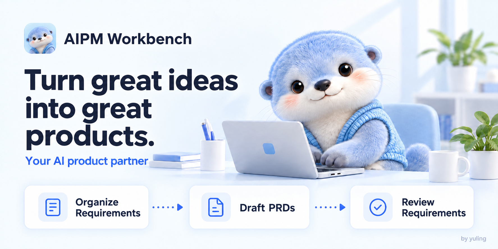
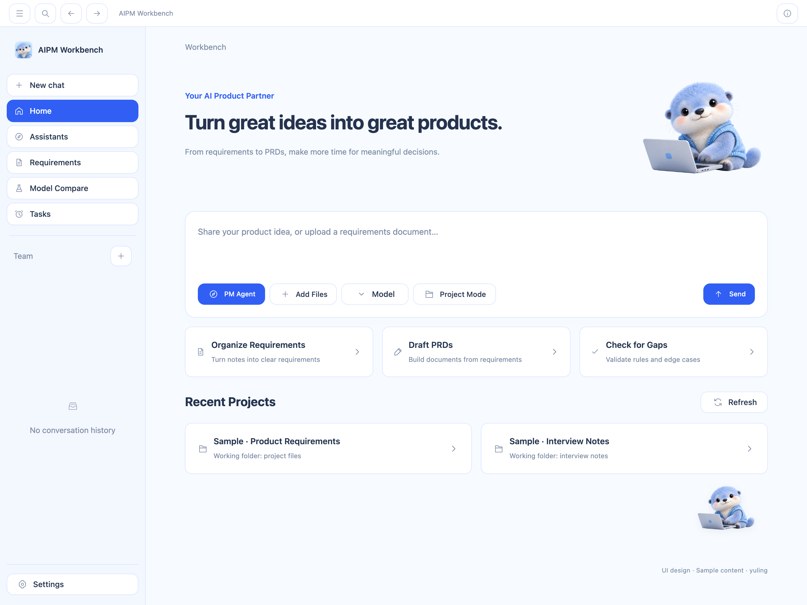

<p align="center">
  <a href="README.md"></a>
  <a href="README.zh-CN.md"></a>
</p>

<div align="center">
  
  <h1>AIPM Workbench</h1>
  <p>Turn great ideas into great products.</p>
  <p>Help product teams turn scattered ideas into clear requirements, draft PRDs, and prepare for reviews.</p>
  <p>Created by yuling</p>
  <p>
    <a href="#the-problem-it-solves">The problem</a> ·
    <a href="#how-it-helps-product-teams">Team value</a> ·
    <a href="#when-to-use-it">Use cases</a> ·
    <a href="#getting-started">Get started</a>
  </p>
</div>



## The problem it solves

Product management involves more than writing a PRD. Much of the work goes into organizing information, confirming rules, and keeping people aligned. Ideas from meetings get buried in chat histories. Documents describe the happy path but miss exceptions. After several changes, engineers and testers need to check which version to follow.

AIPM Workbench brings AI assistants, project materials, requirement cards, checks, and version records together. It helps you turn source materials into requirements that have a clear basis, can be discussed, and can be verified.

Let AI prepare a first draft, then add business rules, verify sources, and resolve open questions before sharing it for review. A PRD is a product requirements document: it explains the problem to solve, what to build, and how to judge whether the result meets the requirements.

## How it helps product teams

| A common challenge | How the workbench helps | Value for the team |
| --- | --- | --- |
| Starting every PRD from a blank page and repeatedly organizing background, flows, and rules | Use the product manager assistant and quick prompts to draft from existing materials, then complete and verify the content | Give drafting a clear structure so product managers can focus on goals, scope, and priorities |
| Scattered discussions and unclear reasons behind requirements | Turn materials or chat messages into requirement cards, retain sources, and list missing information as open questions | Trace the basis for a requirement and distinguish decisions from questions that still need answers |
| Requirements cover the happy path but miss exceptions and acceptance criteria | Complete structured fields and run rule-based checks or AI checks with a configured model | Discuss specific rules, exceptions, and acceptance criteria with engineering and testing |
| Repeated changes make it hard to remember what changed and which documents need attention | Save requirement versions, compare changes, and check linked documents after a requirement changes | Identify decisions that need another review and documents that need manual updates |
| Review and handoff materials must be assembled repeatedly | Export requirements, sources, open questions, and check results as a Markdown review draft for the current version | Give reviewers a verifiable snapshot and a clear basis for handoff discussions |
| Model responses vary, making it hard to choose based on memory alone | Compare 2–4 models with the same prompt and materials, inspect each response, and save the results | Assess a model's suitability based on business accuracy, omissions, and completeness |

Different team members can use these capabilities in their work:

- Product managers: organize requirements from materials and discussions, draft PRDs, and retain sources and open questions for each requirement.
- Engineers: use business rules, exceptions, and version changes to clarify implementation scope and unresolved details.
- Testers: discuss test coverage and pass criteria using acceptance criteria and exception flows.
- Project leads: use review materials containing issues, rules, and changes to guide discussions and decide the next steps.

Teams can discuss exported review drafts and requirement content together. Requirement cards and version records are stored locally on the user's computer.

## When to use it

### You have a pile of materials and need to clarify the requirements

Meeting notes, chat histories, product ideas, and documents can all serve as input. On the home screen, select the product manager assistant and a model, add background and materials, and choose the requirement-organizing shortcut.

The shortcut inserts a prompt into the input box. Review and send it, then ask the assistant to help identify target users, scenarios, business rules, and open questions. Save the result as a requirement card.

### You need to draft a PRD or prepare for a requirement review

Give the assistant your existing requirements and use the PRD-writing shortcut to organize a draft. Complete the scope, rules, exceptions, and acceptance criteria, then run requirement checks.

Bring unresolved questions to the review. Once addressed, export a Markdown review draft so the discussion can focus on specific content.

### A requirement changes and you need to check the impact

Compare two versions of a requirement to see what changed, then check linked documents. Changes to confirmed requirements need another review.

The workbench records document references and verification status. You update external files yourself, making change verification part of your regular workflow.

### You want to compare models on the same task

Give the same prompt and materials to 2–4 configured models. Compare their accuracy, coverage of business conditions, and usefulness for further editing. Save the results for future reference.

## Main capabilities

| Capability | What you can do |
| --- | --- |
| AI product assistant | Clarify problems from materials, organize requirement and PRD drafts, and check for omissions |
| Project materials and conversations | Add local project folders to conversations to keep discussions grounded in actual materials |
| Structured requirement cards | Record target users, scenarios, problems, goals, scope, rules, exceptions, acceptance criteria, and sources |
| Requirement checks | Check completeness, show open questions, and record the reasoning used to resolve issues |
| Version and change verification | View requirement history, compare content changes, and check linked documents |
| Review draft export | Export Markdown content for team reviews and handoffs |
| Model comparison | Compare responses from configured models, stop or retry runs, and save results |



The home screen brings together idea input, materials, assistant and model selection, and recent projects. The blue otter is the product's companion character and can also be enabled as a desktop pet in Settings.

## Getting started

### Install the Mac app

Apple silicon Mac users can get the installer, source package, and complete UI design package from the [download page](https://github.com/yuling170916/aipm-workbench/releases/tag/aipm-2026.10.10).

Download and open `AIPM-workbench-mac-arm64.dmg`, drag the app into Applications, and launch it.

### Create your first requirement

Start with real requirement materials:

1. Configure a supported model service and your own API key under Settings → Models.
2. Return to the home screen, choose the product manager assistant and a model, and enter your idea or add materials.
3. Use the requirement-organizing shortcut, review the inserted prompt, add business context, and send it.
4. Use the action beside a chat message to turn it into a requirement, then select or create a destination project.
5. Verify and complete the requirement card, save it, run checks, and resolve open questions.
6. Export a Markdown review draft and discuss it with engineers, testers, or other reviewers.

You can also open the requirement workspace, select or create a project, and fill in a card manually or paste materials for AI-assisted organization.

Manual requirement editing, rule-based checks, version records, and export can be used directly. AI features require an available model service. The product manager and product development assistants use the built-in Aion CLI and configured models. External agents may also need their own CLI, sign-in, or authorization.

When a model is called, the prompts and materials needed for the task are sent to the configured service. AI-generated content requires human verification. Confirming a requirement means its content has been checked; implementation and testing still need their own acceptance checks.

For detailed steps and practice examples, see the [user manual (Chinese PDF)](docs/%E4%BD%BF%E7%94%A8%E6%89%8B%E5%86%8C.pdf) or the [editable manual (Chinese Word document)](docs/%E4%BD%BF%E7%94%A8%E6%89%8B%E5%86%8C.docx).

### Run from source

These commands are intended for an Apple silicon Mac. Install Node.js 22–24, Bun, Rust, and the macOS command line developer tools. Use the Rust version specified in `AionCore/rust-toolchain.toml`.

Clone the [source repository](https://github.com/yuling170916/aipm-workbench), or download and extract `AIPM-workbench-yuling-source.zip` from the download page. Open a terminal in `aipm-workbench`, where `AionUi`, `AionCore`, and `docs` are directly accessible. Run these commands in order:

```bash
cd AionCore
cargo build --bin aioncore --locked
cd ../AionUi
bun install --frozen-lockfile
AIONUI_BACKEND_BIN="../AionCore/target/debug/aioncore" bun run start
```

If the initial installation reports a version mismatch between `better-sqlite3` and Electron, run `bunx electron-builder install-app-deps` in `AionUi` and restart. See the [development guide (Chinese)](docs/%E5%BC%80%E5%8F%91%E4%B8%8EGitHub%E4%B8%8A%E4%BC%A0.md) for full startup and build instructions.

Keep API keys, sign-in details, and private materials out of GitHub. They belong in your local usage environment.

## Author and open-source licenses

yuling — product design, development, and maintenance.

The open-source foundation comes from [AionUi](https://github.com/iOfficeAI/AionUi) and [AionCore](https://github.com/iOfficeAI/AionCore). This project retains upstream and third-party licenses and copyright notices.

[Apache-2.0](LICENSE) · [NOTICE](NOTICE)
