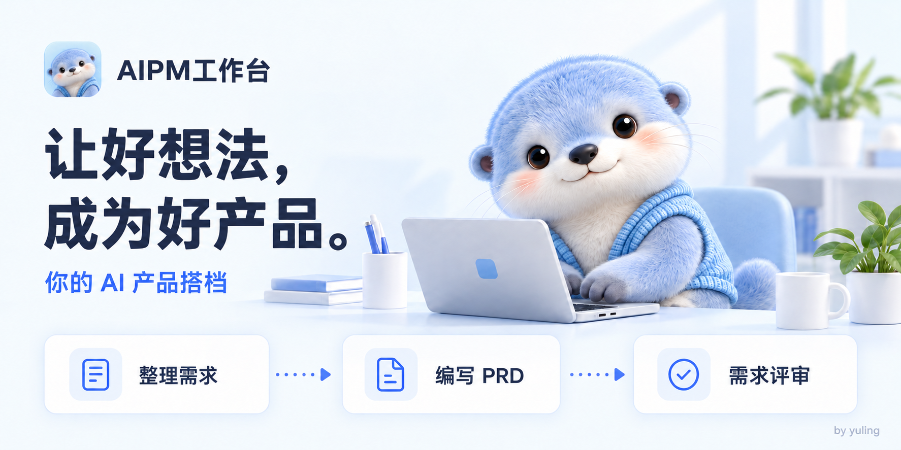
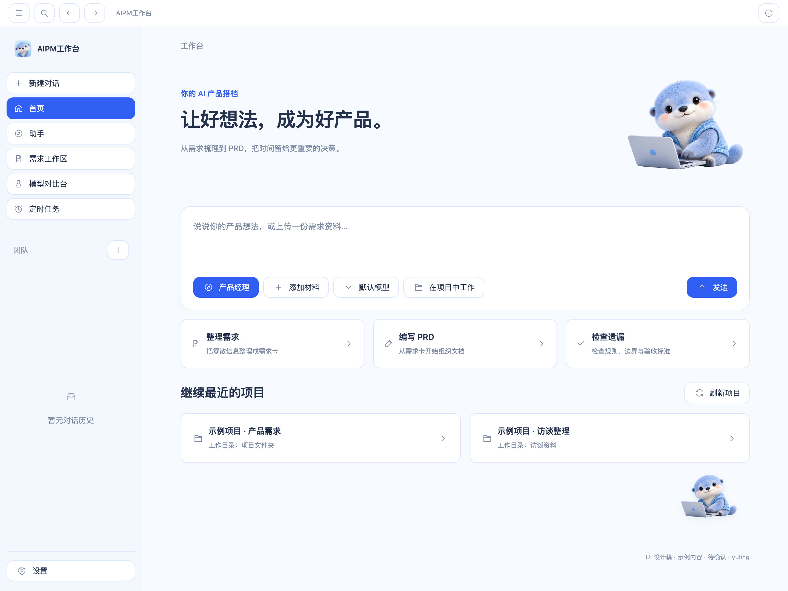

<p align="center">
  <a href="README.md"></a>
  <a href="README.zh-CN.md"></a>
</p>

<div align="center">
  
  <h1>AIPM工作台</h1>
  <p>让好想法，成为好产品。</p>
  <p>帮助产品团队把零散想法整理成清楚的需求，写好 PRD，准备好评审。</p>
  <p>作者：yuling</p>
  <p>
    <a href="#它解决什么问题">解决什么问题</a> ·
    <a href="#能为产品团队带来什么">团队价值</a> ·
    <a href="#哪些时候适合使用">使用场景</a> ·
    <a href="#开始使用">开始使用</a>
  </p>
</div>



## 它解决什么问题

产品经理的工作不只是写一份 PRD。更多时间花在整理信息、确认规则和反复沟通上：会议里提过的想法散落在聊天记录中，文档写出了正常流程却遗漏异常情况，需求改了几次以后，研发和测试又需要重新确认执行哪个版本。

AIPM工作台把 AI 助手、项目资料、需求卡、体检和版本记录放在一起，帮助使用者把材料整理成有依据、能讨论、可核对的需求内容。

你可以让 AI 先起草，再补充业务规则、核对来源、处理待确认问题，最后把评审稿交给团队讨论。PRD 指产品需求文档；它的作用是让大家清楚要解决什么问题、做哪些内容，以及怎样判断结果符合要求。

## 能为产品团队带来什么

| 工作中遇到的问题 | 工作台怎样帮助处理 | 对团队的价值 |
| --- | --- | --- |
| PRD 从空白开始写，反复整理背景、流程和规则 | 使用产品经理助手和快捷提示词，围绕已有材料组织文档草稿，再由使用者补充和核对 | 把起草工作变得更有章法，让产品经理把精力放在目标、范围与优先级上 |
| 讨论记录分散，需求依据说不清楚 | 将材料或聊天消息整理成需求卡，保留来源，把未知信息列为待确认事项 | 评审时可以追溯依据，区分已经决定的内容与仍需确认的问题 |
| 需求只写正常流程，异常和验收条件容易遗漏 | 补齐结构化字段，运行规则体检，或使用已配置模型进行 AI 体检 | 产品、研发和测试可以围绕具体规则、异常与验收标准讨论 |
| 需求反复修改，记不清改了什么、影响了哪些资料 | 保存需求版本，比较差异，并在需求变化后提示核对关联文档 | 方便识别需要重新讨论的决定和需要人工更新的资料 |
| 评审与交接材料需要反复整理 | 将需求、来源、待确认问题和体检结果整理为当前版本的 Markdown 评审稿 | 给评审参与者一份可核对的内容快照，让交接有明确的讨论对象 |
| 模型回答差异大，凭印象难以选择 | 使用相同提示词与材料比较 2～4 个模型，分别查看回答并保存记录 | 便于按业务准确性、遗漏情况和内容完整度判断模型是否适合任务 |

这些能力可以用于不同角色的工作：

- 产品经理：从材料和讨论中整理需求，起草 PRD，保留每项需求的依据与待确认问题。
- 研发同学：围绕业务规则、异常情况和版本差异，确认实现范围与需要澄清的细节。
- 测试同学：从需求中的验收标准和异常流程出发，讨论测试覆盖与判断条件。
- 项目负责人：拿到包含问题、规则与变更信息的评审材料，组织讨论并确认下一步。

团队可以围绕导出的评审稿和需求内容开展讨论；需求卡与版本记录保存在使用者本机。

## 哪些时候适合使用

### 收到一堆材料，需要先把需求整理清楚

会议纪要、聊天记录、产品想法和文档，都可以作为整理材料。在首页选择产品经理助手与模型，添加背景和材料，点击“整理需求”。

快捷卡会把提示词补入输入框。检查并发送后，让助手协助梳理目标用户、使用场景、业务规则和待确认问题，再保存为需求卡。

### 要写 PRD，或者准备开需求评审

把已有需求交给助手，通过“编写 PRD”入口组织草稿。补齐范围、规则、异常情况和验收标准后，再运行需求体检。

将仍需确认的问题带到评审中，处理后导出 Markdown 评审稿。团队讨论可以围绕具体内容展开，而不只是逐页阅读文档。

### 需求发生变化，需要重新确认影响

查看需求的两个版本，比较哪些内容发生了变化，再核对关联文档。已确认的需求修改后，需要重新评审。

工作台记录文档引用和核对状态，外部文件由使用者更新，便于把变更核对这一步纳入日常工作。

### 要比较不同模型对同一个任务的表现

将同一份提示词和材料交给 2～4 个已配置的模型。比较回答是否准确、是否遗漏业务条件、是否适合继续编辑，并保存结果供后续参考。

## 工作台中的主要能力

| 能力 | 可以完成的工作 |
| --- | --- |
| AI 产品助手 | 围绕材料梳理问题、组织需求与 PRD 草稿，辅助检查遗漏 |
| 项目资料与对话 | 将本地项目文件夹加入对话，让讨论围绕实际资料展开 |
| 结构化需求卡 | 保存目标用户、场景、问题、目标、范围、规则、异常、验收标准与来源 |
| 需求体检 | 检查需求完整性，呈现待确认事项，记录问题处理依据 |
| 版本与变更核对 | 查看需求历史、比较内容差异、核对关联文档 |
| 评审稿导出 | 导出 Markdown 内容，用于团队评审与交接 |
| 模型对比 | 对比多个已配置模型的回答，停止、重试并保存记录 |



首页集中提供想法输入、材料添加、助手与模型选择，以及最近项目入口。蓝绒獭是产品的陪伴形象，也可以在设置中作为桌面宠物启用。

## 开始使用

### 安装 Mac 应用

Apple 芯片 Mac 用户可以在[下载页](https://github.com/yuling170916/aipm-workbench/releases/tag/aipm-2026.10.10)获取安装包、源码包与完整 UI 设计包。

下载并打开 `AIPM-workbench-mac-arm64.dmg`，将 `AIPM工作台.app` 拖入「应用程序」，然后双击启动。本地交付的同一安装包名为 `AIPM工作台-Mac-Apple芯片.dmg`。

### 完成第一份需求

启动应用后，先用一份真实需求材料试一次：

1. 在“设置 → 模型”中配置支持的模型服务与自己的 API Key。
2. 回到首页，分别选择产品经理助手和模型，输入想法或添加材料。
3. 点击“整理需求”，检查补入的草稿，补充业务背景后发送。
4. 点击聊天消息旁的“整理为需求”，选择或创建目标项目。
5. 核对并补充需求卡，点击“保存这张需求卡”，再运行体检、处理待确认问题。
6. 导出 Markdown 评审稿，与研发、测试或其他评审参与者核对。

也可以直接进入需求工作区，选择或创建项目，手工填写需求卡，或粘贴材料后使用 AI 整理。

需求手工编辑、规则体检、版本记录与导出可以直接使用。AI 能力需要可用的模型服务。产品经理助手和产品开发助手使用内置 Aion CLI 与已配置模型；外部 Agent 可能还需要对应 CLI、登录或授权。

调用模型时，任务所需的提示词和材料会交给所配置的服务处理。AI 生成的内容需要人工核对；确认需求表示核对了内容，开发完成与测试通过仍需另行验收。

完整操作步骤与练习示例见[使用手册](docs/使用手册.pdf)，也提供[Word 版本](docs/使用手册.docx)。

### 从源码启动

以下命令面向 Apple 芯片 Mac。准备 Node.js 22～24、Bun、Rust 和 macOS 命令行开发工具；Rust 版本以 `AionCore/rust-toolchain.toml` 为准。

克隆[源码仓库](https://github.com/yuling170916/aipm-workbench)，或从下载页获取 `AIPM-workbench-yuling-source.zip` 并解压。在 `aipm-workbench` 目录打开终端；目录中直接包含 `AionUi`、`AionCore` 和 `docs`。依次运行：

```bash
cd AionCore
cargo build --bin aioncore --locked
cd ../AionUi
bun install --frozen-lockfile
AIONUI_BACKEND_BIN="../AionCore/target/debug/aioncore" bun run start
```

首次安装若提示 `better-sqlite3` 与 Electron 版本不匹配，在 `AionUi` 中运行 `bunx electron-builder install-app-deps` 后重启。完整启动和构建步骤见[开发指南](docs/开发与GitHub上传.md)。

API Key、登录信息和私人材料保存在本机使用环境中，不应提交到 GitHub。

## 作者与开源许可

yuling — 产品设计、开发与维护。

开源基础来自 [AionUi](https://github.com/iOfficeAI/AionUi) 与 [AionCore](https://github.com/iOfficeAI/AionCore)。本项目保留上游及第三方许可证和版权声明。

[Apache-2.0](LICENSE) · [NOTICE](NOTICE)
